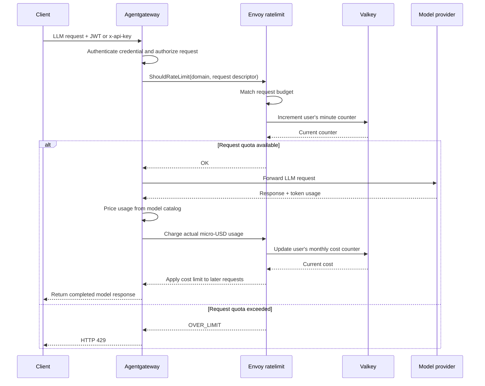

# Agentgateway rate limiting

## Request flow



For a request to `/v1/*`, Agentgateway first validates the supplied credential. The demo accepts either a valid Vault JWT or a configured API key; the LLM authorization rule requires at least one. Counters use the credential's username metadata (`apiKey.username` for API keys, otherwise the JWT `username` claim), not the raw API-key value.

The `remoteRateLimit` policy sends a gRPC `ShouldRateLimit` check to `ratelimit:8081`, with domain `agentgateway`. The request descriptor uses the shared username (`apiKey.username` for API keys, otherwise `jwt.username`); cost descriptors separately identify JWT users and the `test` API key. The Envoy rate-limit service ([upstream docs](https://agentgateway.dev/docs/standalone/latest/documentation/configuration/resiliency/rate-limits/)) matches descriptors against [config/ratelimit.yaml](config/ratelimit.yaml), updates shared counters in Valkey, and replies. An `OK` lets Agentgateway forward the request to the model provider. An `OVER_LIMIT` becomes HTTP `429`; the request is not forwarded. These policies apply to LLM requests, not the separate MCP or A2A routes.

Only the `test-ratelimit` API-key username has a request-count limit: 1 request per fixed minute bucket. Other usernames have no request-count limit. Requests continue incrementing the test bucket after it is over limit, so its value can exceed the configured quota.

Each JWT username has a $100 spend limit per fixed 30-day month (`100000000` micro-USD). The `test` API-key username has a separate $10 spend limit (`10000000` micro-USD) over the same period. Agentgateway computes `llm.cost.total` from the catalog loaded at `/config/costs/catalog.json`, converts dollars to micro-USD, and charges that amount after model usage is returned. Since actual cost is only known at completion, the request that crosses the budget still completes and may incur additional spend; subsequent requests are limited. Refresh pricing with `make model-catalog-refresh` before starting Compose; the catalog is mounted read-only. Only models with matching catalog prices are covered by a spend limit. The custom `decision-1` SystemOne model has no catalog price and is not cost-capped; unpriced-model requests remain subject to a request-count limit only for `test-ratelimit`. Other API-key usernames have no request-count or spend limit.

`failureMode: failClosed` means Agentgateway rejects requests if it cannot reach the rate-limit service, rather than silently skipping request and spend enforcement.

## Inspect Valkey

Start the stack if needed, then open the Valkey CLI:

```sh
docker compose up -d
docker compose exec -it valkey valkey-cli
```

In the CLI, find the test user's counters and inspect one:

```text
KEYS '*test-ratelimit*'
TYPE agentgateway_user_test-ratelimit_<minute-bucket>
GET agentgateway_user_test-ratelimit_<minute-bucket>
TTL agentgateway_user_test-ratelimit_<minute-bucket>
INFO keyspace
```

`KEYS` is fine for this small local demo; prefer `SCAN 0 MATCH '*test-ratelimit*' COUNT 100` on larger stores. Copy the actual key returned by `KEYS`/`SCAN` in place of `<minute-bucket>` above.

The key is assembled as `[cache-prefix]domain_descriptor-key_descriptor-value_bucket-start`. The current empty prefix and test request descriptor produce a key like `agentgateway_user_test-ratelimit_1790000000`; the final number is the Unix timestamp at the start of that minute. `GET` returns the counter as an integer string: each request adds one. The service sets an expiry for cleanup; with this image's default 300-second expiry jitter, a minute-bucket key can remain for about 60–360 seconds. The next minute uses a different bucket key, so an old key does not consume the new minute's quota. `TTL` reports seconds remaining before that stored key is deleted.

`INFO` reports server-level sections; `INFO keyspace` summarizes databases and is not a per-key lookup. Use `TYPE`, `GET`, and `TTL` for an individual key. To clear only the inspected bucket and retry the test, run `DEL <actual-key>`.
